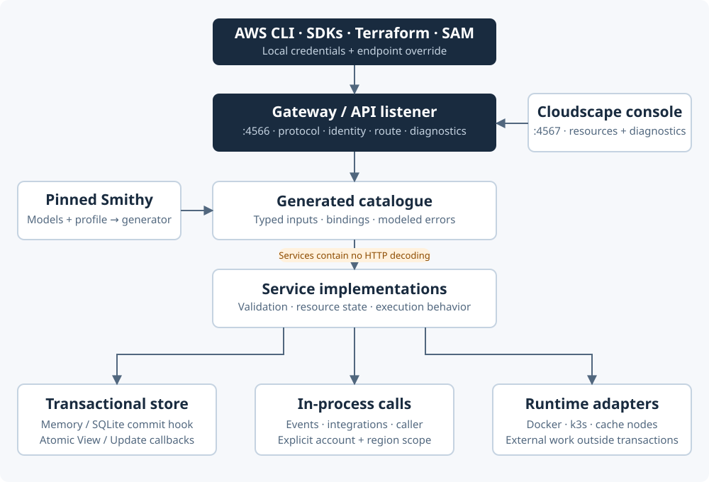

# System architecture

TinyStack shares one gateway, one generated service catalogue, and one transactional store across its local AWS services.
The service packages implement behavior over typed inputs; protocol codecs handle the HTTP wire format.

## Responsibilities

| Layer | Owns | Source |
| --- | --- | --- |
| CLI and startup | Configuration, storage, listeners, console and signal handling | `internal/cmd/start.go` |
| Assembly | Service construction, registration, cross-service wiring and stop order | `internal/app/` |
| Gateway | Protocol classification, identity, routing, decoding, response encoding and diagnostics | `internal/gateway/` |
| Generated catalogue | API interfaces, types, operation bindings, modeled errors and capabilities | `internal/aws/generated/` |
| Protocol codecs | AWS JSON, Query, EC2 Query, REST XML/JSON and RPC v2 CBOR envelopes | `internal/aws/protocol/` |
| Service implementations | Validation, resource state and cross-service behavior | `internal/services/` |
| Storage | Serializable callback transactions and commit persistence | `internal/storage/` |
| Runtime adapters | Docker processes and engine lifecycle outside transactions | Service-specific `docker/` and `k3s/` packages |
| Console | Cloudscape resource and diagnostics views | `ui/` and `internal/console/` |

The [repository map](../development/repository.md) links these paths to their source.

## One API port, several data planes

The default API listener is `127.0.0.1:4566`. The console has a separate listener on `4567` and never passes
its page requests through AWS protocol classification. Its diagnostics requests use the same internal handler.

The API listener also serves Docker Registry requests, API Gateway invocations, AppSync GraphQL and subscriptions,
function URLs, load balancer HTTP requests, and MQTT WebSocket upgrades through specialized handlers.
IoT plain/TLS MQTT can use extra listeners. Docker runtimes return their own cache or Kubernetes endpoints.

## Favor local correctness over production scale

Services share reusable identity, pagination, tagging, policy-document, background-work and delivery-log helpers.
Resource state uses small records and stable key prefixes. Some searches and indexes scan local state instead of
building production-style distributed indexes. Records-only services do not launch compute or networking resources.

Use the [service pages](../services/index.md) to distinguish executable behavior from metadata, and the
[roadmap](../roadmap/index.md) for proposed extensions.

## Explore a boundary

- [Request and protocol flow](request-flow.md)
- [Identity and scoping](identity.md)
- [Storage transactions](storage.md)
- [Events and runtimes](events-runtimes.md)
- [Model generation](generation.md)
